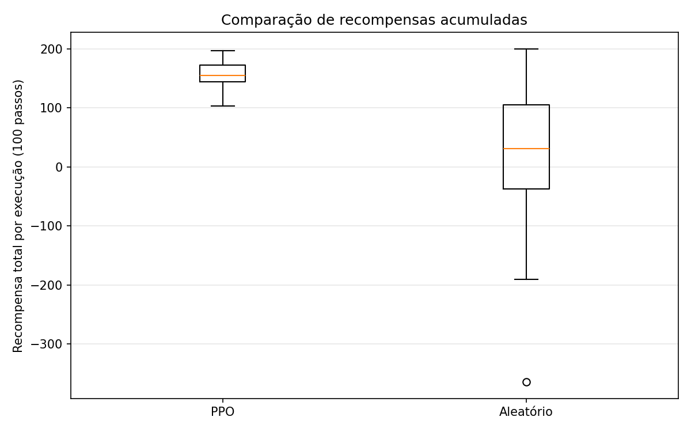
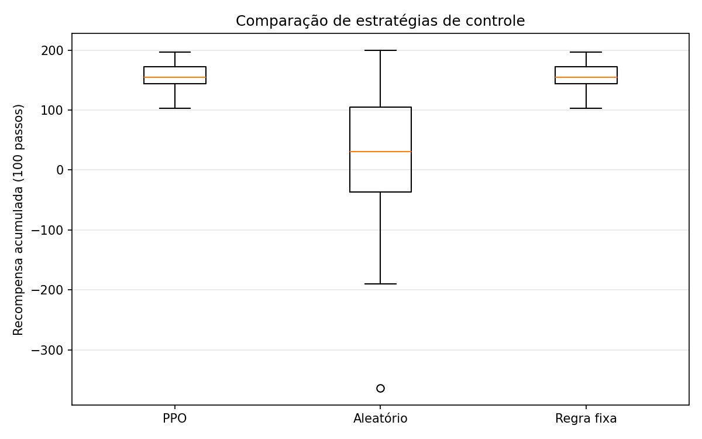

# PPO Traffic Control — Aprendizado por Reforço

Projeto acadêmico desenvolvido individualmente em **2024** para explorar **aprendizado por reforço (Reinforcement Learning)** em um ambiente simplificado de controle de tráfego. O agente foi treinado com **Proximal Policy Optimization (PPO)** para selecionar ações e maximizar recompensas associadas aos níveis de congestionamento simulados.

Em **2026**, o projeto foi recuperado e recebeu uma avaliação comparativa com duas políticas de referência: seleção aleatória de ações e uma regra fixa.

> **Escopo:** este é um experimento didático em um ambiente numérico simplificado, não um sistema de gerenciamento de trânsito real.

## Tecnologias

- Python 3.10
- Gymnasium
- Stable-Baselines3 (PPO)
- PyTorch (dependência do Stable-Baselines3)
- NumPy
- Matplotlib
- Jupyter Notebook (opcional, para os experimentos em `notebooks/`)

## Como funciona

O ambiente personalizado, implementado em `environment.py`, representa o congestionamento em **quatro regiões** por meio de um vetor de observações numéricas.

A cada passo:

1. O agente recebe o estado atual do ambiente.
2. Escolhe uma das **três ações** disponíveis (`0`, `1` ou `2`).
3. O ambiente atualiza os níveis de congestionamento.
4. O agente recebe uma recompensa de acordo com a condição resultante.

A função de recompensa do experimento utiliza os valores **+2** (condição favorável), **−1** (intermediária) e **−5** (desfavorável). O agente PPO busca maximizar a recompensa acumulada.

O treinamento original foi configurado para **10.000 passos**. O modelo resultante está salvo em `ppo_traffic_control.zip`.

## Estrutura do projeto

```text
ppo-traffic-control/
├── images/
│   ├── comparacao_agentes.png
│   └── comparacao_tres_agentes.png
├── notebooks/
├── environment.py
├── train.py
├── evaluate.py
├── test_environment.py
├── compare_agents.py
├── ppo_traffic_control.zip
├── rewards.csv
├── requirements.txt
├── .gitignore
└── README.md
```

| Arquivo | Finalidade |
| --- | --- |
| `environment.py` | Ambiente personalizado, estados, ações e recompensas |
| `train.py` | Treinamento do agente PPO |
| `evaluate.py` | Avaliação do modelo salvo e registro de recompensas |
| `test_environment.py` | Verificação básica da interação com o ambiente |
| `compare_agents.py` | Comparação entre PPO, política aleatória e regra fixa |
| `ppo_traffic_control.zip` | Modelo treinado em 2024 |
| `rewards.csv` | Recompensas registradas em uma execução de avaliação |
| `notebooks/` | Experimentos realizados no Jupyter Notebook |

## Como executar

### 1. Pré-requisitos

- Python **3.10** instalado.
- Git (caso queira clonar o repositório).

Clone o repositório e entre na pasta:

```bash
git clone https://github.com/bruna-crist/ppo-traffic-control.git
cd ppo-traffic-control
```

Ou abra diretamente a pasta do projeto no terminal.

### 2. Crie e ative um ambiente virtual

No **PowerShell (Windows)**:

```powershell
py -3.10 -m venv .venv
.\.venv\Scripts\Activate.ps1
```

### 3. Instale as dependências

```powershell
python -m pip install --upgrade pip
python -m pip install -r requirements.txt
```

As versões utilizadas para recuperar o projeto em 2026 incluem **Gymnasium 0.29.1**, **Stable-Baselines3 2.3.2** e **NumPy 1.26.4**. Recomenda-se fixá-las no `requirements.txt` para facilitar a reprodução do ambiente.

### 4. Teste o ambiente

```powershell
python test_environment.py
```

### 5. Avalie o modelo treinado

```powershell
python evaluate.py
```

O script carrega o modelo salvo, executa passos de avaliação e apresenta um gráfico de recompensas.

> **Atenção:** `evaluate.py` pode sobrescrever `rewards.csv`. Faça uma cópia caso queira preservar os dados anteriores.

### 6. Compare as estratégias

```powershell
python compare_agents.py
```

O script executa as avaliações comparativas e gera os gráficos utilizados neste README.

### 7. Treinamento (opcional)

```powershell
python train.py
```

> **Atenção:** um novo treinamento pode sobrescrever `ppo_traffic_control.zip`. Faça uma cópia do modelo original antes de executar esse comando.

## Avaliação comparativa (2026)

Foram comparadas três estratégias, cada uma avaliada em **30 execuções de 100 passos**:

- **PPO:** decisões tomadas pelo modelo treinado.
- **Aleatório:** ações escolhidas aleatoriamente.
- **Regra fixa:** seleção constante da ação `1`.

As médias abaixo correspondem às execuções realizadas na revisão de 2026.

### Experimento 1 — PPO vs. política aleatória



| Estratégia | Recompensa média acumulada |
| --- | ---: |
| PPO | **157,60** |
| Aleatório | **14,20** |

O PPO obteve recompensa média maior e menor dispersão que a política aleatória nesse experimento.

### Experimento 2 — PPO vs. aleatório vs. regra fixa



| Estratégia | Recompensa média acumulada |
| --- | ---: |
| PPO | **157,60** |
| Aleatório | **14,20** |
| Regra fixa (ação `1`) | **157,60** |

O PPO superou a política aleatória, mas **não apresentou vantagem sobre a regra fixa**. Nesse ambiente, a ação `1` reduz o congestionamento de forma suficientemente previsível para que uma estratégia simples alcance a mesma recompensa média.

**Interpretação:** os resultados demonstram que o agente treinado executa uma política eficaz em relação à escolha aleatória, mas **não comprovam que o aprendizado por reforço seja necessário ou superior a regras simples** para este problema. As comparações são descritivas; não foi realizado teste de significância estatística.

## Limitações conhecidas

- **Simulação simplificada:** o estado representa quatro níveis numéricos de congestionamento, sem modelar vias, semáforos ou veículos reais.
- **Ações previsíveis:** a ação `1` tende a reduzir o congestionamento, simplificando a decisão ótima.
- **Reprodutibilidade:** o ambiente original utiliza aleatoriedade que merece uma revisão do controle de sementes (*seeds*).
- **Avaliação:** a comparação utiliza 30 execuções por estratégia, sem inferência estatística formal ou avaliação em cenários de tráfego realistas.
- **Compatibilidade do modelo salvo:** ao carregar o modelo antigo, podem aparecer avisos de desserialização relativos a `clip_range` e `lr_schedule`. Na revisão de 2026, isso não impediu a execução das previsões, mas pode afetar a retomada do treinamento.

## Melhorias futuras

- Modelar ações cujos efeitos dependam do estado do trânsito.
- Adicionar restrições e dinâmicas mais realistas ao ambiente.
- Corrigir e testar o controle de sementes para experimentos reproduzíveis.
- Comparar novas políticas e avaliar resultados em múltiplos cenários.
- Incluir testes automatizados de conformidade com a API do Gymnasium.

## Histórico do projeto

- **2024:** desenvolvimento independente do ambiente, treinamento do agente PPO, experimentos e avaliação inicial como trabalho acadêmico.
- **2026:** recuperação do ambiente Python, execução do modelo salvo e inclusão de comparações com políticas aleatória e de regra fixa.

## Autoria

Desenvolvido por **[Bruna Cristina](https://github.com/bruna-crist)**.
